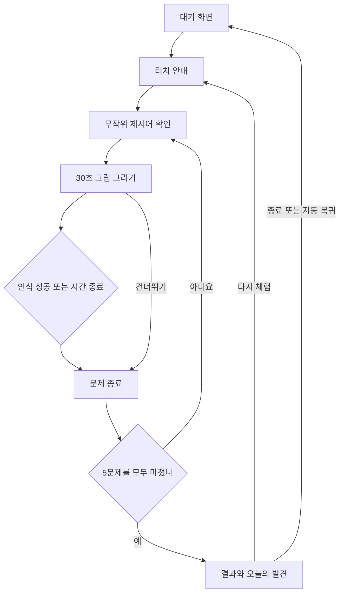
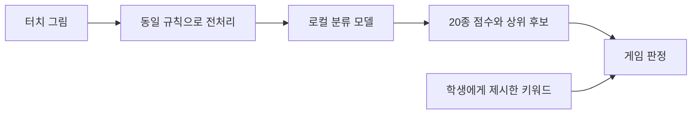

# 부여 AI센터 그림 맞히기 키오스크 PRD

학생이 터치스크린에 그림을 그리면 로컬 AI가 무엇을 그리는지 추측하는 3~5분 체험 프로그램이다. 초등학생이 안내 직원의 개입 없이 참여하고, 그림의 특징을 추가할 때 AI의 예상이 달라지는 모습을 관찰하도록 만든다.

| 항목 | 내용 |
| --- | --- |
| 작성일 | 2026년 10월 29일 |
| 문서 버전 | 0.3 |
| 최근 수정 | 2026년 11월 13일 시제품 피드백 반영(타이머 시작 시점, 성공 유지 시간, 머신러닝 소개 화면) |
| 상태 | 개발 기준 초안 |
| 대상 | 기획자, UI 개발자, 모델 개발자, 현장 운영 담당자 |
| 프로그램 이름 | AI 낙서 탐정 가칭 |
| 기본 환경 | PC 1대와 터치패널 1개, 세로형 1080×1920 |

회차당 5문제, 문제당 30초를 개발 기본값으로 제안한다. 20개 키워드와 무작위 출제는 합의한 요구사항이며, 회차 구성과 아래의 수치 목표는 현장 검증을 통해 조정할 개발 기준이다.

## 제품 목표와 확정 조건

체험의 핵심은 학생이 선을 더할수록 AI의 예상 후보가 바뀌는 경험이다. 결과를 빨리 맞히는 재미와 함께, AI가 사람들의 그림에서 배운 패턴을 이용하며 헷갈리거나 틀릴 수 있다는 점을 전달한다.

| 구분 | 확정된 조건 |
| --- | --- |
| 조작 | 체험 시작부터 종료까지 터치만 사용한다. 키보드, 마우스, 문자 입력을 요구하지 않는다. |
| 이용 시간 | 처음 방문한 학생의 안내부터 결과 확인까지 3~5분을 목표로 한다. |
| 실행 | 체험 중 외부 API를 호출하지 않는다. 최초 실행과 재시작도 인터넷 연결 없이 가능해야 한다. |
| 대상 | 초등학생이 주 이용자이며 중학교 저학년도 참여할 수 있어야 한다. |
| 화면 | 첫 버전은 세로형 1080×1920에 맞춘다. |
| 문제 | 합의한 20개 키워드에서 무작위로 출제한다. 난도순으로 진행하지 않는다. |
| AI | 실제 그림 분류 모델로 추론한다. 제시어에 맞춘 정답 연출을 사용하지 않는다. |

학생은 체험 후 다음 두 가지를 자기 말로 설명할 수 있어야 한다.

- 특징을 더 그리면 AI의 예상이 달라질 수 있다.
- AI는 배운 그림의 패턴으로 추측하며 언제나 맞히지는 않는다.

## 첫 버전의 개발 범위

| 우선순위 | 포함 기능 |
| --- | --- |
| P0 필수 | 20종 그림 분류 모델, 중복 없는 무작위 출제, 회차 진행과 제한 시간, 터치 드로잉, 실시간 예상 후보, 한 획 지우기, 전체 지우기, 건너뛰기, 결과 화면, 오프라인 실행, 유휴 상태 복귀, 오류 복구 |
| P1 후속 | 로컬 음성 안내, 터치로 사용하는 관리자 설정, 운영 통계 내보내기, 다른 세로형 화면 크기 지원 |
| 이번 범위에서 제외 | 회원가입, 학생 이름 입력, 클라우드 저장, 외부 AI 서비스 연동, 카메라와 마이크 입력, 학생 그림을 이용한 실시간 재학습, 온라인 순위, 그림 생성 기능 |

P0의 안내는 글, 아이콘, 애니메이션만으로 이해할 수 있어야 한다. 음성이 없는 환경에서도 모든 기능을 사용할 수 있어야 한다.

## 문제은행

아래 번호는 콘텐츠 관리와 그리기 난도 참고용이다. 실제 출제 순서나 추첨 가중치로 사용하지 않는다. 난도는 학생이 손가락으로 특징을 표현하는 정도를 기준으로 정한 기획값이며, AI 인식 난도와는 구분한다.

| 번호 | 학생용 키워드 | 모델 클래스 ID | 난도 참고 | 표현 특징 |
| --- | --- | --- | --- | --- |
| 1 | 딸기 | strawberry | 입문 | 몸통, 꼭지, 씨앗 |
| 2 | 버섯 | mushroom | 입문 | 넓은 갓과 짧은 기둥 |
| 3 | 포도 | grapes | 입문 | 여러 알의 송이 형태 |
| 4 | 아이스크림 | ice_cream | 입문 | 콘과 위쪽 아이스크림 |
| 5 | 우산 | umbrella | 쉬움 | 둥근 지붕과 손잡이 |
| 6 | 파인애플 | pineapple | 쉬움 | 뾰족한 잎과 몸통 무늬 |
| 7 | 열기구 | hot_air_balloon | 쉬움 | 풍선, 연결 줄, 바구니 |
| 8 | 달팽이 | snail | 쉬움 | 나선형 집, 몸, 더듬이 |
| 9 | 토끼 | rabbit | 보통 | 긴 귀와 몸의 비율 |
| 10 | 펭귄 | penguin | 보통 | 배, 짧은 날개, 부리와 발 |
| 11 | 기타 | guitar | 보통 | 잘록한 몸통과 긴 목 |
| 12 | 문어 | octopus | 보통 | 머리와 여러 구불구불한 다리 |
| 13 | 바다거북 | sea_turtle | 도전 | 등껍질, 머리, 지느러미 |
| 14 | 코끼리 | elephant | 도전 | 긴 코와 큰 귀 |
| 15 | 기린 | giraffe | 도전 | 긴 목과 작은 머리 |
| 16 | 소방차 | firetruck | 도전 | 차량, 사다리, 경광등 |
| 17 | 헬리콥터 | helicopter | 어려움 | 몸체, 꼬리, 프로펠러 |
| 18 | 악어 | crocodile | 어려움 | 긴 주둥이, 낮은 몸, 꼬리 |
| 19 | 자전거 | bicycle | 어려움 | 바퀴 두 개, 프레임, 핸들, 안장 |
| 20 | 캥거루 | kangaroo | 최종 도전 | 작은 앞발, 큰 뒷다리, 굵은 꼬리 |

모델 클래스 ID는 앱 내부의 고정 식별자다. 원본 데이터의 `ice cream`, `hot air balloon`, `sea turtle`은 데이터 준비 과정에서 각각 위의 ID로 매핑한다. 모델 출력 인덱스와 클래스 ID의 관계는 버전이 붙은 라벨 파일에 명시한다.

20개 항목은 [Quick Draw 공식 분류 목록](https://raw.githubusercontent.com/googlecreativelab/quickdraw-dataset/master/categories.txt)에 대응한다. 키워드 변경 시에는 데이터, 모델 출력, 라벨, 화면 문구를 함께 갱신한다.

## 출제와 회차 규칙

### 무작위 출제

- 회차 시작 시 20개 클래스 ID를 균등하게 섞고 앞에서 5개를 선택한다. 한 회차에는 같은 키워드가 두 번 나오지 않는다.
- 각 키워드가 한 회차에 포함될 확률은 기본 설정에서 5/20으로 같다. 난도별 할당, 쉬운 문제 우선, 직전 이용자의 결과에 따른 가중치는 적용하지 않는다.
- 선택한 5개는 섞인 순서 그대로 출제한다. 회차 시작 시 문제 목록을 확정하고 진행 중 다시 추첨하지 않는다.
- 다음 이용자의 회차는 독립적으로 새로 추첨한다. 서로 다른 회차 사이에는 같은 키워드가 다시 나올 수 있다.
- 건너뛰기는 현재 문제를 소비한다. 추가 문제를 뽑거나 총 문제 수를 늘리지 않는다.
- 테스트에서는 난수 시드를 고정해 같은 회차를 재현할 수 있어야 한다.

### 시간과 판정

| 항목 | 제안 기본값과 동작 |
| --- | --- |
| 회차당 문제 수 | 5문제 |
| 그림 시간 | 문제당 30초 |
| 타이머 시작 | 그리기 화면에서 학생이 첫 선을 긋는 순간. 선을 긋기 전에는 시간이 흐르지 않는다 |
| 인식 성공 | AI의 최상위 후보가 제시어와 같고, 신뢰 기준과 유지 시간을 충족한 경우 |
| 성공 이후 | 현재 그림을 고정하고 피드백 화면으로 이동한다. 남은 시간을 기다리지 않는다. |
| 시간 종료 | 그림을 고정하고 AI가 마지막에 무엇으로 추측했는지 보여준다. |
| 건너뛰기 | 현재 문제를 건너뜀으로 기록하고 다음 문제로 이동한다. 빈 그림으로 억지 판정하지 않는다. |
| 피드백 화면 | 다음 문제 버튼을 제공하고, 조작이 없으면 6초 뒤 자동으로 이동한다. 마지막 문제는 결과 화면으로 이동한다. |
| 최종 결과 | 최대 45초간 표시하며, 종료 또는 다시 체험 버튼으로 즉시 이동할 수 있다. |

30초 타이머는 획을 지우거나 그림을 다시 그려도 초기화되지 않는다. 한 획을 되돌리거나 도화지 전체를 지우면 이전 인식 후보와 성공 대기 상태를 초기화한다.

학생이 마지막 순간까지 그릴 수 있도록 마감 시점의 그림을 확정한 뒤 최종 추론을 한 번 실행한다. 이 최종 판정은 점수와 마감 기준을 충족하면 성공으로 처리하며, 이전 문제나 수정 전 그림의 응답은 사용하지 않는다. 최종 판정 대기는 최대 1초다.

일반 이용자의 흐름은 안내 15~25초, 제시어 확인 총 20~30초, 그림 총 100~150초, 문제별 피드백 총 15~30초, 결과 확인 20~40초로 설계한다. 처음 이용하는 학생의 실제 소요 시간을 측정해 3~5분에 맞춘다. 빨리 완료한 학생에게 3분을 채우기 위한 대기를 강제하지 않는다.

## 화면과 사용자 흐름

### 대기 화면

큰 체험 시작 버튼, 활동을 이해할 수 있는 짧은 드로잉 애니메이션, 약 3~5분 표시를 제공한다. 모델과 필수 자원이 준비된 이후에만 시작 버튼을 활성화한다. 모델 오류 시 체험을 시작시키지 않고 다시 준비 버튼을 표시한다.

### 머신러닝 소개

체험 시작 직후, 게임 방법 안내 앞에 AI가 그림을 알아보는 원리를 세 단계로 보여 준다. ① 사람들이 그린 그림 약 30만 장에서 특징을 배운다. ② 내 그림을 28×28 칸 그림으로 바꿔 특징을 찾는다. ③ 20가지 중 가장 비슷한 것을 고르며 처음 보는 모양은 헷갈릴 수 있다. 마지막에 이런 방법을 머신러닝이라고 부른다고 알린다. 다시 체험할 때는 이 화면을 건너뛰고 게임 방법부터 보여 준다.

### 터치 안내

게임 규칙(문제 수, 첫 선부터 흐르는 제한 시간, 성공 조건, 건너뛰기)을 함께 보여 준다. 손가락으로 그리기, 한 획 지우기, AI 예상 확인하기를 짧게 설명한다. 10~15초 분량의 로컬 애니메이션과 준비됐어요 버튼을 제공한다. 안내 예시는 정식 문제 수에 포함하지 않는다.

### 제시어 확인

문제 번호와 이번 제시어를 큰 글자로 표시한다. 제시어는 학생에게만 제공하고 인식 모델 입력에 넣지 않는다. 정답 그림이나 윤곽선은 표시하지 않는다. 그리기 시작 버튼을 누른 뒤 그림 화면으로 이동한다.

### 그림 그리기

상단에는 제시어, 현재 문제 번호, 남은 시간을 고정한다. 중앙에는 넓은 도화지를 배치한다. AI의 말풍선에는 대표 예상 하나를 표시하고, 보조 영역에 상위 후보를 최대 3개까지 보여준다. 하단에는 한 획 지우기, 전체 지우기, 건너뛰기를 배치한다.

AI 문구는 판정 상태에 따라 구분한다.

| 상황 | 학생용 문구 예시 |
| --- | --- |
| 아직 그림이 없음 | 몇 획 그려 주면 내가 맞혀 볼게! |
| 정보가 부족함 | 아직 잘 모르겠어. 특징을 더 그려 줄래? |
| 예상 후보가 있음 | 혹시 달팽이일까? |
| 제시어 인식 성공 | 아하, 달팽이구나! |
| 시간 종료 | 이번에는 내가 알아보지 못했어. 다음 그림도 만나 보자! |

모델 점수를 학생에게 정답 확률이나 그림 실력 점수로 표시하지 않는다. 제한된 20종 가운데 추측한다는 점은 안내에서 짧게 알린다.

### 문제별 피드백

해당 제시어와 학생 그림, 알아봄 또는 아직 못 알아봄 또는 건너뜀 상태를 표시한다. 시간 종료 시 마지막 AI 추측도 함께 표시한다. 실패를 학생의 그림 실력 탓으로 표현하지 않는다.

### 최종 결과

5개 문제의 제시어와 그림을 카드로 보여준다. 대표 지표는 AI가 알아본 그림 3개처럼 표시한다. 건너뛴 문제와 빈 그림은 별도 상태로 구분한다. 속도 가산점, 등급, 다른 학생과의 순위는 제공하지 않는다.

오늘의 발견에는 다음 내용을 짧은 애니메이션과 함께 보여준다.

> AI는 사람들이 그린 여러 그림에서 특징을 배웠어요. 내가 특징을 더 그리면 예상이 달라질 수 있고, 익숙하지 않은 그림은 헷갈릴 수도 있어요.

## 터치 화면 설계 기준

| 항목 | 요구사항 |
| --- | --- |
| 기준 해상도 | 1080×1920, 세로형, 화면 스크롤 없음 |
| 도화지 | 기준 화면에서 너비 900px 이상, 높이 900px 이상 확보 목표 |
| 주요 버튼 | 높이 100~120px 이상, 인접 버튼 간 간격 16px 이상을 초기 설계값으로 적용 |
| 글자 | 본문 30px 이상, 제시어 56px 이상을 초기 설계값으로 적용 |
| 손가락 가림 | 핵심 조작은 도화지 밖에 배치하고 타이머와 제시어가 손에 가리지 않도록 한다. |
| 설치 높이 | 실제 스크린 크기와 설치 높이에서 초등 저학년의 손 도달 범위를 확인한다. 픽셀 크기만으로 판단하지 않는다. |
| 터치 입력 | 단일 손가락 드로잉, 화면 확대와 페이지 이동 제스처 방지, 도화지 밖으로 나갔다 돌아오는 획 처리 |
| 다중 터치 | 두 번째 손가락과 손바닥 접촉이 획 추가나 버튼 오작동을 만들지 않도록 한다. |
| 선 | 단색 펜 하나를 사용한다. 펜 굵기는 드로잉 테스트로 정하고 색과 굵기 선택 UI는 제공하지 않는다. |
| 지우기 | 한 획 단위 되돌리기와 도화지 전체 지우기를 제공한다. |
| 접근성 | 색상 외에 문구와 아이콘으로 상태를 전달하고, 번쩍이는 효과를 피한다. 소리가 없어도 완료할 수 있어야 한다. |

난도가 높은 문제도 자유롭게 건너뛸 수 있어야 한다. 글을 읽는 데 시간이 걸리는 학생에게 불리하지 않도록 제시어 확인 단계에서 그림 타이머를 시작하지 않는다.

## AI 모델과 독립적인 정답 판정

### 모델의 역할

모델 하나가 현재 그림을 보고 20개 클래스의 점수를 출력한다. 학생이 그리는 동안 모델 가중치를 변경하지 않는다. 제시어, 현재 정답, 선택된 5개 문제 목록, 난도 정보는 모델 입력과 후보 필터에 사용하지 않는다.

게임 로직은 모델의 전체 20종 예측 중 최상위 후보를 제시어와 비교해 성공 여부를 결정한다. 모든 입력에 동일한 전처리 규칙과 빈 입력 검사를 적용한다. 빈 그림은 모델 예측과 성공 판정에서 제외하고, 낙서나 제시어와 다른 단어를 그린 경우에도 동일한 모델로 평가한다.

### 모델과 입력 규격 제안

- 작은 합성곱 신경망 CNN을 사용한다. 초기 입력은 28×28 흑백 이미지, 출력은 20종 점수로 잡는다.
- 그림 영역 추출, 종횡비 유지, 가운데 배치, 여백, 선 두께와 명암 정규화를 학습과 실행 환경에서 일치시킨다.
- 확대와 축소 과정에서 손가락으로 그린 작은 그림이나 화면 모서리의 그림이 부당하게 잘리지 않도록 한다.
- 빈 그림과 극히 짧은 접촉은 충분한 입력이 없는 상태로 처리한다. 제한된 클래스 모델이므로 점수가 높아도 모든 종류의 그림을 이해한다고 표현하지 않는다.
- 28×28 입력으로 목표를 충족하지 못하면 64×64 입력과 구조 변경을 검토한다. 확정한 입력 규칙은 모델 버전에 포함한다.
- 모델 가중치 파일은 1MB 안팎을 초기 목표로 잡고, 성능이 필요하면 3MB까지 허용한다. 실행 라이브러리와 설치 프로그램 용량은 별도로 기록한다.

공개 Quick Draw 데이터는 클래스별 그림과 28×28 흑백 비트맵 형식을 제공한다. 이 데이터를 시작점으로 사용하되 실제 터치 화면에서 만든 입력과의 차이를 검증한다. [공식 데이터 설명](https://github.com/googlecreativelab/quickdraw-dataset)

### 실시간 추론과 성공 조건

| 항목 | 제안 기준 |
| --- | --- |
| 추론 요청 | 변경된 그림만 기본 250ms 간격으로 평가한다. 센터 PC 실행 기준에 따라 500ms로 조절하며 손가락을 떼면 최신 그림을 우선 평가한다. |
| 동시 작업 | 추론은 한 번에 하나만 실행하고, 밀린 입력은 최신 상태 하나로 합친다. |
| 예상 표시 | 상위 후보를 최대 3개 표시하되 낮은 점수에서는 아직 모르겠다는 문구를 우선한다. |
| 후보 안정화 | 대표 후보는 불필요하게 깜빡이지 않도록 변경 간격을 조절한다. 내부 성공 판정은 최신 예측을 사용한다. |
| 성공 초기값 | 최상위 클래스가 제시어와 같고 점수 0.75 이상, 1위와 2위 점수 차이 0.20 이상인 상태가 2,000ms 이상 유지될 때. 유지 시간은 운영자 설정 `successHoldMs`로 조절한다(시제품 600ms는 다 그리기 전에 끝난다는 피드백) |
| 최종 판정 | 제한 시간 종료 직전 입력은 확정된 마지막 그림으로 위 점수와 점수 차이 기준을 평가한다. 유지 시간 조건은 면제한다. |

성공 기준의 수치는 검증 데이터에서 오인식과 인식 지연을 비교해 조정한다. 기준 조정에는 검증 세트만 사용하고, 최종 시험 세트는 합격 여부 확인에 사용한다. 높은 모델 점수는 검증된 정답 확률로 해석하지 않는다.

각 추론에는 회차 ID, 문제 ID, 입력 버전을 붙인다. 이전 문제의 응답과 이미 적용한 입력보다 오래된 응답은 버린다. 지우기와 다시 그리기 이후에는 기존 후보 유지 시간을 초기화한다. 손가락을 뗀 뒤에는 마지막 예측이 유지되는지를 타이머로 확인하며, 동일 그림을 반복 계산해 유지 시간을 채울 필요는 없다.

## 학습 데이터와 검증

| 구분 | 초기 준비 기준 |
| --- | --- |
| 개발용 학습 데이터 | 20종 각각 최소 5,000장으로 시작 |
| 검증 데이터 | 20종 각각 최소 500장 |
| 최종 시험 데이터 | 20종 각각 최소 500장 |
| 분리 | 파일과 샘플 식별자를 기록하고 동일 그림의 중복과 증강본이 서로 다른 세트에 섞이지 않게 한다. |
| 데이터 증강 | 위치, 크기, 선 굵기, 약한 회전 등을 학습 세트에 적용한다. 실제 펜 입력과 맞는 범위에서 사용한다. |
| 데이터 관리 | 원본 출처, 취득일, 원본 및 가공 파일 체크섬, 분리 기준, 라벨 매핑, 학습 설정을 기록한다. |
| 출처 표시 | 사용한 데이터와 실행 라이브러리의 출처 및 라이선스 원문을 배포물에 포함한다. |

완성된 그림 데이터로 학습한 모델은 그리는 중간 단계에서 다른 반응을 보일 수 있다. 별도 획 데이터로 부분 그림을 만들거나, 개발용 터치 그림을 단계별로 수집해 중간 예측을 검증한다. 부분 그림에서의 불확실함과 완성 그림의 인식 실패를 분리해 측정한다.

정식 키오스크에 들어간 학생의 그림은 자동으로 학습 데이터가 되지 않는다. 개발 검증용 그림 수집이 필요하면 일반 체험 운영과 구분한 절차로 진행한다.

## 실행 구조와 배포

### 확정된 센터 PC와 실행 기준

센터가 제공한 사양은 Intel Core i3-13100, 메모리 8GB, Samsung PM9B1 512GB, 별도 그래픽카드 없음이다. 운영체제 버전과 실제 가용 메모리는 설치 전에 확인한다.

20종의 작은 흑백 그림 분류 모델과 2D 터치 화면은 이 사양에서 CPU만으로 실행하도록 설계한다. 하드웨어 증설을 전제로 하지 않는다. 실행 가능성은 모델 구조와 작업량에 근거한 판단이며, 최종 안정성은 완성된 모델과 현장 장비로 성능 및 연속 운영 검증을 통과한 뒤 확정한다.

| 항목 | 센터 PC에 적용할 기준 |
| --- | --- |
| AI 실행 | WASM CPU 전용. 전용 GPU 기능에 의존하지 않음 |
| 모델 | 28×28 입력과 20종 출력의 CNN 하나. 초기 파라미터 25만 개 이하와 가중치 약 1MB 이내 목표 |
| 모델 변경 | 데이터와 전처리를 먼저 개선. 64×64 입력이나 더 큰 모델은 현장 성능 재검증 후 적용 |
| 추론 빈도 | 변경된 그림만 기본 250ms 간격. 진행 중 추론 1개와 최신 대기 입력 1개만 유지 |
| 부하 조절 | 최근 20회의 추론 P95가 150ms를 넘으면 요청 간격을 500ms로 전환. 정상 속도 복귀 여부는 다음 회차 시작 시 판단 |
| 스레드 | 추론용 Web Worker 하나와 WASM 연산 스레드 하나 |
| 메모리 | 앱 전체 프로세스의 물리 메모리 합계 600MB 이하 목표. 정상 체험 중 최대 1GB 이하를 합격 기준으로 검증 |
| 화면 | 2D Canvas. 도화지 내부 비트맵 최대 1080×1080. 장치 배율만큼 무조건 확대하지 않음 |
| 자원 재사용 | 앱 준비 시 모델을 한 번 로딩해 회차 사이 재사용. 입력 버퍼와 추론 텐서는 해제 또는 재사용 |
| 보관 상한 | 현재 회차 최대 5개 그림. 원본 좌표는 문제당 최대 10,000점으로 관리하고 초과 입력은 모양을 유지하며 단순화 |
| 배포 | 학습 데이터와 Python 학습 환경은 개발 PC에서 사용. 체험 PC에는 모델과 실행 자원만 동봉 |

8GB 전체가 앱에 제공된다고 가정하지 않는다. Windows와 센터의 필수 백그라운드 프로그램을 실행한 상태에서 메모리를 검증한다. 작은 모델 파일도 실행 메모리는 별도로 필요하므로 앱의 모든 프로세스를 합산한다.

Intel 공식 사양의 i3-13100에는 UHD Graphics 730 내장 그래픽이 포함된다. AI 추론은 CPU로 실행하고 화면 표시에 내장 그래픽을 사용할 수 있다. [Intel 공식 사양](https://www.intel.com/content/www/us/en/products/sku/230575/intel-core-i313100-processor-12m-cache-up-to-4-50-ghz/specifications.html)

### 권장 구성

| 구성 요소 | 제안 구현 |
| --- | --- |
| 화면 | TypeScript와 HTML Canvas, 터치용 Pointer Events |
| 추론 | Web Worker에서 ONNX Runtime Web의 WASM CPU 실행 |
| 모델 학습 | 개발 환경에서 Python으로 학습한 뒤 ONNX로 내보내기 |
| 개발 시제품 | 로컬 웹서버와 브라우저 |
| 현장 배포 | 브라우저 실행 환경과 모델을 포함한 PC용 설치 패키지. Windows용 Electron 패키지를 우선 검토 |
| 자원 | 모델, 라벨, 설정, JavaScript, WASM, 폰트, 그림, 안내 애니메이션을 모두 로컬에 포함 |

ONNX Runtime Web 배포에는 JavaScript, WASM, 모델 파일이 필요하므로 모두 같은 설치 패키지에 넣고 경로를 명시한다. 라이브러리의 CDN 기본 경로나 온라인 모델 다운로드에 의존하지 않는다. [공식 배포 문서](https://onnxruntime.ai/docs/tutorials/web/deploy.html)

WASM 단일 스레드 CPU 실행과 별도 Web Worker를 센터 PC 기본 구성으로 사용한다. 런타임 버전과 모델 내보내기 규격을 맞춰 고정한다. [실행 설정 문서](https://onnxruntime.ai/docs/tutorials/web/env-flags-and-session-options.html)

### 모델 배포 단위

모델 파일, 라벨 순서, 전처리 규칙, 성공 기준을 하나의 버전 묶음으로 배포한다. 앱은 시작할 때 파일 존재와 체크섬, 출력 클래스 수, 라벨 수를 확인한다. 호환되지 않으면 체험을 열지 않는다. 이전에 검증한 묶음을 보관해 운영자가 되돌릴 수 있어야 한다.

현장 체험에는 Python, 모델 학습 도구, API 키, 별도 서버 PC가 필요하지 않아야 한다. 외부 통신 없이 동작하도록 앱 내부의 자동 업데이트, 분석 도구, 오류 전송과 원격 자원을 제거한다. 업데이트는 운영자가 준비한 패키지로 수행한다.

## 상태 관리와 현장 복구

| 상황 | 요구 동작 |
| --- | --- |
| 모델 준비 | 준비 화면을 표시하고 로딩과 시험 추론이 완료된 뒤 시작 버튼을 연다. |
| 준비 실패 | 그림 친구를 준비하지 못했어요와 다시 준비 버튼을 표시한다. 성공 결과를 연출하지 않는다. |
| 진행 중 추론이 1초 넘게 지연 | 타이머를 일시 정지하고 준비 중 상태를 표시한다. |
| 5초 내 복구 | 현재 그림과 남은 시간을 유지해 재개한다. |
| 5초 초과 또는 작업 오류 | 현재 문제를 기술 오류로 제외하고 체험을 종료한다. 이전 그림은 결과로 볼 수 있게 하고, 준비 화면으로 복귀한다. |
| 학생이 그리기를 멈춤 | 그리기 화면에서는 30초 타이머를 정상 진행한다. 입력이 없다고 타이머를 멈추지 않는다. |
| 대기성 화면에서 60초 무조작 | 소개, 안내, 제시어 확인, 첫 선을 긋기 전의 그리기 화면에서 계속할까요를 표시한다. 10초 동안 응답이 없으면 회차를 정리한다. |
| 결과 화면 45초 경과 | 그림과 회차 정보를 삭제하고 대기 화면으로 복귀한다. |
| 다음 이용자 시작 | 이전 그림, 예상 후보, 타이머, 결과가 남지 않도록 새 회차를 만든다. |
| 앱 재시작 | 모델을 다시 준비한 뒤 대기 화면에서 시작한다. 중단된 학생 회차는 복구하지 않는다. |

기술 오류는 AI가 그림을 알아보지 못한 경우와 다른 상태로 기록한다. 오류 메시지는 학생이 할 수 있는 행동을 안내하고, 기술 로그는 운영자 진단 영역에 남긴다.

관리 설정은 학생 화면에 노출하지 않는다. 첫 버전에서는 운영자가 로컬 설정 파일로 회차당 문제 수, 시간, 자동 복귀 시간 등을 변경할 수 있게 하고 앱 시작 시 값의 범위를 검사한다. 관리자 작업은 학생 체험 중에는 수행하지 않는다.

## 데이터 보관과 운영 지표

학생 이름, 학년, 연락처, 사진, 음성, 계정은 입력받지 않는다. 그림은 현재 회차의 메모리에만 보관하고 결과 화면 종료, 무조작 복귀, 앱 종료 시 정리한다. 재시작 후 그림을 복원하는 영구 저장 기능은 제공하지 않는다.

운영 진단에는 식별자와 그림 없이 로컬 집계값만 남긴다.

- 전체 체험 시작 수와 정상 완료 수
- 키워드별 출제, 알아봄, 시간 종료, 건너뜀 횟수
- 체험 소요 시간과 추론 시간의 집계
- 모델 로딩 실패, 추론 오류, 자동 복귀 횟수
- 앱과 모델 버전

정상 완료율은 기술 오류 없이 결과 화면에 도달한 회차 수를 시작한 회차 수로 나눈 값이다. 체험 인식률은 기술 오류를 제외한 전체 출제 문제 중 AI가 알아본 문제의 비율이며, 시간 종료와 건너뜀도 분모에 포함한다. 키워드별 비율을 따로 확인해 일부 단어의 실패가 평균에 가려지지 않게 한다.

## 품질 목표와 완료 기준

아래 수치는 초기 합격 목표다. 최종 현장 PC에서 측정하며 CPU, 메모리, 운영체제, 앱 및 모델 버전을 검증 기록에 남긴다.

| 영역 | 합격 목표와 검증 방법 |
| --- | --- |
| 터치 완결성 | 시작, 5문제 진행, 지우기, 건너뛰기, 결과 확인, 종료를 키보드와 마우스 없이 수행 |
| 오프라인 | 인터넷을 끊은 상태에서 설치된 앱의 최초 실행, 재실행, 10회 연속 체험 성공 |
| 외부 요청 | 체험 과정에서 외부 도메인 요청 0건. 외부 요청을 차단한 환경에서도 동일 동작 |
| 준비 시간 | 앱 실행 후 체험 시작 가능 상태까지 10초 이내 목표 |
| 드로잉 | 손가락 이동이 선에 반영되기까지 P95 50ms 이내 목표 |
| 추론 | 전처리부터 예측 반환까지 P95 150ms 이내 목표 |
| 표시 | 기본 모드에서 새 선 입력 후 AI 예상 표시까지 P95 400ms 이내 목표. 500ms 간격의 부하 조절 모드에서는 P95 750ms 이내 |
| 메모리 | i3-13100 및 8GB 장비에서 앱 전체 프로세스 물리 메모리 합계 최대 1GB 이하. 20회 예열 후 100회까지 회차 종료 시 측정값이 계속 증가하면 누수 원인을 수정하고 재검증 |
| 완성 그림 인식 | 별도 시험 세트에서 Top 1 정확도 85% 이상, 클래스별 재현율 65% 이상 목표 |
| 현장 인식 | 초등학생 파일럿에서 제한 시간 내 체험 인식률 75% 이상 목표 |
| 체험 시간 | 첫 이용 학생의 완료 시간 중앙값이 3~5분 안에 들도록 구성 조정 |
| 자율 진행 | 파일럿 학생의 80% 이상이 직원의 조작 도움 없이 정상 완료 |
| 안정성 | 8시간 연속 운영과 100회 반복 체험에서 비정상 종료 및 다음 회차에 이전 그림이 남는 현상 0건 |

P95는 측정값의 95%가 해당 시간 안에 들어오는 기준이다. 파일럿은 초등 저학년을 포함한 최소 20명과 그림 100장 이상으로 진행하며, 키워드별 최소 5장을 확보할 때까지 보완한다. 이 중 10명 이상에게 결과 화면의 핵심 문구를 보여 준 뒤 AI가 무엇을 보고 맞혔는지 물어 교육 메시지의 이해도를 확인한다.

## 필수 인수 시나리오

| ID | 검증 내용 | 기대 결과 |
| --- | --- | --- |
| AC01 | 20개 문제은행으로 회차 생성 | 5개가 중복 없이 선택되고 난도순 정렬 없이 출제됨 |
| AC02 | 고정 난수와 다수 회차로 추첨 검사 | 같은 시드에서 재현되며 각 키워드의 선택 확률이 동일한 구현임을 확인 |
| AC03 | 같은 그림에 제시어만 바꾸어 추론 | 모델의 전체 20종 점수와 후보가 동일함 |
| AC04 | 아무것도 그리지 않고 대기 | 정답 판정 없이 시간이 종료되고 빈 그림 상태로 기록 |
| AC05 | 제시어와 다른 그림 입력 | 현재 제시어를 강제로 예상하거나 성공 처리하지 않음 |
| AC06 | 그림 추가와 획 지우기 반복 | 입력 변경을 반영하고 오래된 예측과 성공 유지 상태가 남지 않음 |
| AC07 | 성공과 시간 종료가 비슷한 시점에 발생 | 문제 종료 이벤트가 한 번만 적용되고 마지막 그림 기준으로 일관되게 판정 |
| AC08 | 손가락을 떼고 후보가 유지됨 | 새 획을 요구하지 않고 유지 시간 이후 성공 판정 가능 |
| AC09 | 두 손가락 접촉과 도화지 경계 이동 | 원치 않는 선, 화면 이동, 확대, 버튼 입력이 발생하지 않음 |
| AC10 | 건너뛰기와 마지막 문제 종료 | 추가 추첨 없이 정확히 5개 문제로 회차 종료 |
| AC11 | 네트워크 차단 후 앱 시작과 재시작 | 모델, 글꼴, 안내를 포함해 정상 동작 |
| AC12 | 모델 파일 누락과 라벨 불일치 | 체험 시작을 막고 복구 버튼과 진단 정보를 제공 |
| AC13 | 추론 지연과 Worker 오류 발생 | 타이머와 그림을 보존해 복구하거나 기술 오류로 종료 |
| AC14 | 결과 종료와 무조작 복귀 후 다음 회차 | 이전 회차의 그림과 추측에 대한 앱의 참조를 제거하고 화면에 다시 표시하지 않음 |
| AC15 | 실제 1080×1920 터치패널에서 전 과정 진행 | 스크롤과 가려진 조작 없이 초등학생이 터치만으로 완료 |

## 개발 단계와 산출물

| 단계 | 수행 내용 | 완료 산출물 |
| --- | --- | --- |
| 1 모델 검증 | 20종 데이터 준비, 전처리 확정, 경량 모델 학습, 성능과 혼동 항목 확인 | 모델과 라벨, 학습 설정, 데이터 분리 기록, 시험 성적과 혼동 행렬 |
| 2 플레이 시제품 | 터치 도화지, 실시간 추론, 무작위 5문제, 제한 시간, 결과 흐름 연결 | 로컬에서 실제 모델로 작동하는 시제품 |
| 3 키오스크 완성 | 세로형 UI, 오류 복구, 자동 복귀, 오프라인 패키지, 운영 진단 구현 | 설치 패키지, 설정 예시, 운영 및 복구 설명서 |
| 4 현장 검증 | 실제 패널 성능, 초등학생 파일럿, 단어별 인식과 안내 이해도 확인 | 검증 결과와 개선한 모델 및 앱 버전 |
| 5 납품 | 검증한 버전 고정, 라이선스와 출처 정리, 설치와 재시작 확인 | 소스, 설치 파일, 모델 묶음, 검사 기록, 운영 문서 |

화면만으로 진행하는 모의 판정 버전은 실제 모델과 연결한 시제품의 완료로 간주하지 않는다. 실제 모델의 20종 예측과 오프라인 실행이 연결되어야 2단계가 완료된다.

## 개발 전에 확인할 현장 정보

현재 내용으로 모델 검증과 화면 설계를 시작할 수 있다. 다음 정보는 현장 배포와 최종 수치 검증 전에 확인한다.

| 항목 | 확인 목적 |
| --- | --- |
| 운영체제 버전과 실제 가용 메모리 | CPU i3-13100, RAM 8GB, 저장장치 512GB, 외장 GPU 없음은 확인 완료. 패키지 호환성과 센터 상주 프로그램을 포함한 성능 검증 |
| 패널 인치, 설치 높이, 터치 드라이버와 다중 터치 특성 | 버튼의 실제 크기와 저학년 손 도달 범위 검증 |
| 센터 로고와 기존 전시 디자인 | 정식 화면의 브랜드 적용 |
| 스피커 사용 가능 여부와 주변 소음 | 후속 음성 안내의 필요성 판단 |
| 회차당 5문제와 30초 기본값의 파일럿 결과 | 무작위 난도에서 3~5분 체험과 인식 경험 조정 |

무작위 출제와 20개 문제은행을 유지하면서 안내, 모델, 시간 설정을 개선하는 것을 기본 방향으로 한다.
